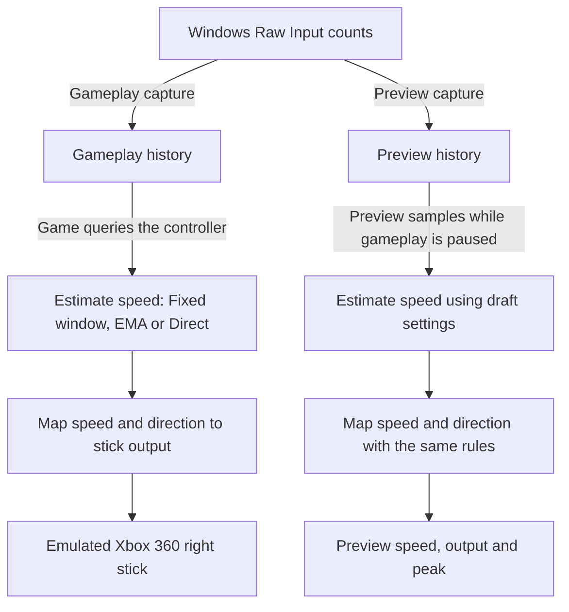
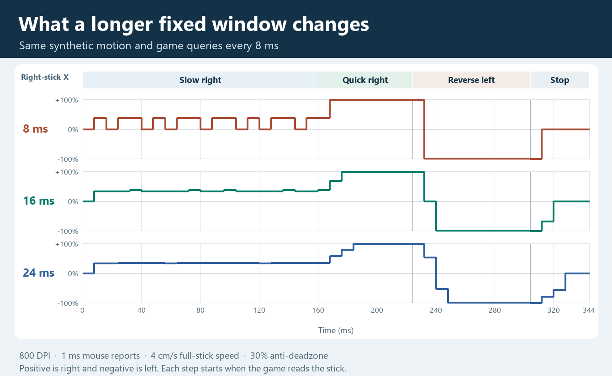

# KBM Design and Testing

[User guide](../kbm_input.md) · [Mouse tuning](tuning.md)
· [How it works](#how-the-estimators-work)
· [Experiments](#mouse-timing-experiments) · [Replay tools](#replay-tools)
· [AI analysis](#analyzing-a-report-with-ai) · [Build and tests](#build)

This reference explains how KBM translates mouse movement into right-stick
commands and how to check its behavior with experiments or reports.

## How the estimators work

Gameplay input and live preview share the same estimator and mapping math.
Each path keeps its own event history and samples on its own schedule.



Preview works before a game is loaded. It samples after at least 16 ms using
actual elapsed time. Its peak is the highest sampled output. A brief movement
can leave the Fixed window between samples, so preview values can differ
from gameplay for the same movement.

- **Fixed window** sums the counts in the chosen window ending at the game
  query, then divides by the window length. A later query can include the
  same counts until they expire. A wider window also retains more of the
  old motion when you stop or reverse.
- **Direct** divides the counts between game queries by the actual interval.
  **EMA** smooths that speed estimate. For a query interval of Δt and a time
  constant of τ, the weight on the previous estimate is `exp(-Δt/τ)`.
  After at least 12 ms without motion, EMA returns to zero once the speed is at
  or below 2% of the full-stick threshold. After 50 ms, the next query clears
  the output regardless of the remaining speed.
- The game controls when queries reach KBM. FPS can affect that cadence when
  the game ties input queries to its frame updates. Host controller hotkeys
  read KBM buttons without advancing the gameplay mouse estimator.

All modes use the same speed-to-stick mapping. Hardware DPI is the number of
Raw Input counts per inch of travel. At 800 DPI and 10 cm/s, the full-stick
threshold is about 3149.6 counts/s.

```text
full_scale_cps = dpi * full_stick_speed_cm_s / 2.54
magnitude = clamp(hypot(velocity_x, velocity_y) / full_scale_cps, 0, 1)
```

With anti-deadzone off, the amplitude is `magnitude`. With it on, nonzero
output becomes `minimum + (1 - minimum) * magnitude`. A zero speed estimate
always maps to zero. The mapper preserves direction, with optional Y inversion.
Keyboard stick bindings combine with the mouse output using per-axis saturation.
A game can retain its own acceleration and deadzone.

Processing times and physical tuning values are clamped to their ranges.
For NaN or infinity, they use their defaults. Reset, inactive or more than
100 ms between queries produces zero output. A nonpositive interval returns
zero and keeps pending counts for the next advancing query.

## Binding format

The 25 controller binding fields are stored under `[HID.KBM.Bindings]` in
`kbm.toml`, using names such as `a`, `left_trigger`, and `right_thumb_up`.
Regular bindings use logical tokens such as `Key.W`, `Key.ArrowUp`,
`Mouse.Left`, and `Mouse.X1`. Chords use the canonical modifier order
`Ctrl+Alt+Shift+Super+Key.F8`. A modifier by itself uses its key token, such as
`Key.LeftShift`. Modifiers and the main key can be pressed in either order.

Regular controller bindings also support the `_` (lowercase) and `^`
(uppercase) case prefixes. `Key.K` and `Ctrl+Key.K` may both activate when
Ctrl+K is held. Bare key names and Windows virtual-key tokens such as `VK_*`
and `0xNN` are rejected. The mouse capture hotkey accepts one keyboard key
or chord, or an empty binding to disable it. The upstream `keybind_*` fields
in Xenia's main configuration belong to the separate keyboard driver.

## Input report format

Each report includes the per-poll Raw Input delta, the estimated velocity
passed to the stick mapper, mouse right-stick output, game input polling
interval, capture state, and reset, stale or dropped sample counts.
Schema 4 identifies `mapper=physical_linear_radial`, `processing_mode`,
`fixed_window_ms`, and `ema_tau_ms` in its metadata. Reports are published
after recording ends.

Metadata snapshots the active DPI, full-stick speed, anti-deadzone switch,
minimum output, and Y inversion when recording starts. These are active gameplay
settings, not an unsaved preview draft or detected mouse hardware values.
The report does not contain a complete copy of `kbm.toml` or the button bindings.

New reports include a matching `kbm-input-report-<timestamp>.events.csv`.
The sidecar contains recorded Raw Input events, reset markers, and the initial
bucket state. Replay also supports sidecars from schemas 2 and 3.
The timestamps describe host processing, not hardware sampling. Event sequence
numbers associate poll buckets with the event trace. The poll report is published
last and marks a completed pair; a sidecar alone is not a complete report.
Activating changed KBM settings finishes the current capture so its metadata stays valid.

Skip all leading `#` metadata comments when importing. Schema 3 records the
physical Direct estimator. Schema 2 retains its legacy EMA interpretation.
Dropped counters describe recorder capacity.
The event buffer supports up to 600,000 entries and the poll buffer 120,000;
reports expose truncation counts. Keep both files when sharing a new capture.

## Mouse timing experiments

Manual gameplay checks and diagnostic captures included **Gears of War 2**,
**Gears of War 3**, and **Gears of War: Judgment**. The trial compared Direct,
Fixed 8 ms and EMA 8 ms in each title. Fixed 16 ms was also tried in Gears of
War 3. Gameplay feedback favored 8 ms over 4 ms for the EMA default. KBM applies
the same input rules in every title.

### What the fixed window changes



In this example, the 8 ms window sometimes has no counts during slow motion,
so output drops to zero. The 16 ms window keeps that motion continuous. The
24 ms window retains more old motion, so the stick reaches full left and
returns to center later. The lines show the right stick's horizontal output.
Positive is right and negative is left. The game's camera response is separate.

The illustration uses synthetic input at 800 DPI, one mouse report per
millisecond and one controller query every 8 ms. The mouse moves right at
0.25 cm/s until 160 ms, then at 4 cm/s until 224 ms. It reverses to −4 cm/s
until 304 ms and then stops. Cumulative position is rounded to whole counts
at each mouse report. All three windows use 4 cm/s full-stick speed and 30%
anti-deadzone. The broader comparison below uses a separate motion sequence.

At 800 DPI and 0.25 cm/s, covering one count takes about 12.7 ms on average.
That makes the slow segment a useful example of why a short window can be
empty. The 800 DPI value is an input to the example and the product starting
value. Use the active hardware DPI when tuning your own mouse.

### Reproducible synthetic comparison

Run `python -B tools/kbm_compare_modes.py` without a capture to generate the
example. It uses a 1 cm/s slow move, a pause, then an 8 cm/s move followed by
an instant reversal and a stop. It quantizes movement at 800, 1600 and 3200 DPI,
with mouse reports every 1 or 8 ms. Game queries are 8 ms apart with four
offsets (0, 2, 4 and 6 ms). The full-stick speed is 4 cm/s and anti-deadzone is
30% for this experiment. Each mode has 24 trials. Timing medians use the
trials that produced the corresponding output. Fixed 4 ms missed all motion
in six trials where 8 ms mouse reports consistently fell outside the window.

<details>
<summary>Full synthetic comparison (11 mode and time combinations)</summary>

| Mode | Slow output span (percentage points) | First reverse output (ms) | Stop to zero (ms) |
| --- | ---: | ---: | ---: |
| Fixed 4 ms | 5.2 | 8 | 8 |
| Fixed 8 ms | 3.5 | 10 | 11 |
| Fixed 12 ms | 2.3 | 13 | 15 |
| **Fixed 16 ms** | **1.7** | **16** | **19** |
| Fixed 24 ms | 1.2 | 18 | 27 |
| EMA 2 ms | 3.4 | 10 | 17 |
| EMA 4 ms | 3.0 | 10 | 26 |
| EMA 6 ms | 2.6 | 10 | 34 |
| **EMA 8 ms** | **2.2** | **11** | **42** |
| EMA 12 ms | 1.7 | 16 | 53 |
| Direct | 3.5 | 10 | 11 |

</details>

The slow span is the difference between the maximum and minimum stick output
in the slow segment. Going from Fixed 8 ms to 16 ms cuts the median slow span
from 3.5 to 1.7 percentage points and adds 8 ms to the median stop time.
Fixed 24 ms smooths that motion further and takes longer to return to zero.
EMA 4 ms returns to zero in a median 26 ms, compared with 42 ms at 8 ms.
These measurements describe emulated stick commands for this input and
query schedule. A short window can miss motion that arrived before it started.
To test whether frame rate changes *game queries*, repeat the same scene at
both frame rates and record frame times alongside the KBM report. The CSV
alone cannot measure display latency or camera motion.

## Replay tools

Run these commands from the repository root. Replace `report.csv` with the
poll CSV path and keep its matching event CSV beside it.

```powershell
python -B tools/kbm_replay.py report.csv
python -B tools/kbm_compare_modes.py report.csv
python -B tools/kbm_estimator_probe.py
```

- [`kbm_replay.py`](../../tools/kbm_replay.py) reads legacy and current reports.
  Check that `event_bucket_check.available` is true and
  `event_bucket_check.bucket_mismatches` is zero before using event-dependent
  conclusions. For schema 4, check the reconstructed stick output as well.
  Record again if either stream was truncated.
- [`kbm_compare_modes.py`](../../tools/kbm_compare_modes.py) compares Direct,
  Fixed 4/8/12/16/24 ms and EMA 2/4/6/8/12 ms from the same physical-mapping
  capture (schema 3 or 4). For schema 4, it also requires the replayed stick
  output to match the recorded output within 0.003 percentage points.
  This tolerance allows for rounding the two stick axes. The tool takes the
  longest continuously active section and replays it with recorded, evenly
  spaced, alternating, bursty and stalled queries. Without an input file,
  it runs the synthetic comparison above.
- [`kbm_estimator_probe.py`](../../tools/kbm_estimator_probe.py) uses a synthetic
  constant-speed trace to compare a fixed window with a per-event exponential
  impulse estimator across host report rates, query timing and batching. The
  impulse estimator is a research model separate from the shipped EMA, which
  smooths a per-query speed estimate.

For an in-game comparison, record slow corrections, fast reversals and abrupt
stops in one repeatable scene. Hold DPI, full-stick speed, inversion and
anti-deadzone constant across estimators. Start with the recorded query
schedule. Compare the share of slow queries that produce zero and the 95th
percentile (P95) of the change between adjacent slow stick outputs. The tool
selects roughly straight motion at 0.25–1.5 cm/s with a separate 32 ms lookback.
Use synthetic motions for known onset, reversal and stop times, then play the
same scene to judge camera feel.

## Analyzing a report with AI

Start with the replay output and the capture settings. Share the report pair
only if needed, and omit private paths and personal details from what you send.
When available, include the build commit, upstream base, game and scene, frame
rate setting, mouse hardware DPI, and the movement you were trying to compare.

```text
Analyze these KBM captures using the report schema and the replay tools in this
repository. For each capture, list the recorded mode, time settings, DPI,
full-stick speed, anti-deadzone, minimum output, and Y inversion. Use the report
metadata for KBM settings and use hardware DPI only if I provide it.

Check the event sidecar, bucket verification, dropped samples, resets, and
active capture intervals. For schema 4, require the matching sidecar and
confirm the maximum stick replay error is at most 0.003 percentage points
before comparing modes. Report any missing evidence. Compare modes on the
same events, query times, and mapping settings. Show which samples or replay
metrics support each finding, especially around reversals and stops.

Separate measured stick output from hypotheses about the game's camera. For
claims about FPS, frame pacing, camera motion, or display latency, identify
what synchronized frame or camera evidence would be required.
```

## Input lifecycle regression checks

Use a separate test directory and disposable configuration files. Record the
fork revision, integrated upstream base, mouse settings, and results before
changing input behavior. A successful build or portable-core test run does not
verify native Windows event ordering or a game's camera response.

| Check | Procedure | Expected result |
| --- | --- | --- |
| Focus loss | Hold a movement key or mouse button, switch to another application, release it there, and return. | No stuck control. Requested mouse capture can resume on return. |
| Capture toggle | Move the mouse while repeatedly capturing and releasing with F8. | Cursor visibility and clipping match capture state; old movement does not reappear after capture resumes. |
| Host dialogs | Open and close settings while moving or holding a control; repeat with another host dialog. | Guest input is suspended, the cursor is available, and closing the last dialog restores requested capture without stale input. |
| Binding capture | Capture a key, mouse button, and modifier chord; cancel capture with Escape. | Correct binding names, working cancellation, and no unintended controller input while the dialog is open. |
| Capture hotkey binding | Start capturing the hotkey, click a mouse button, then press a keyboard key or chord. | Mouse buttons do not finish the hotkey capture; the supported keyboard input does. Regular controller bindings still accept mouse buttons. |
| Unsupported binding key | While capturing a controller binding, press an unsupported key, then a supported key. | Capture keeps waiting after the unsupported key; the original binding is not silently cleared. |
| Save and cancel | Edit a setting, save it, reopen, then edit and cancel. | Draft edits affect preview only; cancellation retains the last successfully activated settings. |
| Processing defaults and stability | Start with a fresh configuration. Open the processing menu, switch modes, save and reopen. Then restore defaults. | The menu lists Fixed window, EMA smoothing and Direct in that order. Fixed is selected at 16 ms and EMA starts at 8 ms. Switching preserves each time setting. Restoring defaults changes the draft until saved. |
| Live preview | Start a test before loading a game; move, stop, reset the peak, and change tuning. | Output updates without guest polls; stopping returns to zero, and reset or tuning changes clear the peak. |
| Preview capture | Test Escape, Enter, Space, focus loss, binding capture and dialog closure. | Cursor is released; returning focus does not restart preview, and the gameplay F8 request is preserved. |
| Incompatible configuration | Open a v3 or unknown-version file; cancel, reopen, restore defaults and save. | No old fields load; save actions require confirmed Restore all defaults. Cancel preserves the file; successful Save replaces it with v4 without a backup. |
| XAM UI | Exercise game-requested XAM dialogs with short and long durations, with and without a controller connected. | No crash or false successful keystroke; no old mouse movement after the dialog closes. |
| Diagnostic completion | Record a full 60-second gameplay sample while recording frame times. | Reports are readable; compare frame times around completion with a run without sampling. Track any completion stall separately from mouse mapping behavior. |

Host dialogs suspend KBM through the ImGui dialog lifecycle. The XAM UI-active
flag and the host dialog becoming visible are separate transitions; check their
ordering rather than assuming they change simultaneously. The mouse processor
also resets capture history and rejects poll intervals greater than 100 ms.
This timeout describes time between controller polls, not the age of each Raw
Input event, and does not replace focus and capture reset checks.

Host-dialog suspension clears logical keyboard state on both entry and resume.
Keys received for UI navigation or binding capture must not become held guest
controls when the last dialog closes. A new press can activate the binding
again after resume.

Diagnostic completion transfers the completed buffers to one report worker.
The controller query does not copy the buffers, serialize CSV, or write files.
The worker publishes the event file first and the poll CSV last as the report
pair's completion marker. New reports use schema 4; replay still recognizes
legacy report math and rejects unknown schemas/models.

The report worker finishes a timed session at its deadline even if controller
queries stop. Polls and Raw Input events timestamped after the deadline are
excluded from the report. The settings page shows a saving message until
publication finishes. Another session can start after saving completes.
The settings page reports write failures. Stop requests publication
asynchronously, while Cancel discards an active recording. A report already
being saved is allowed to finish.
Shutdown waits for an accepted report to finish and discards an unfinished
recording. The Windows application explicitly shuts down sampling before its
quick-exit path, which bypasses ordinary driver destruction. Frame-time
comparisons during gameplay remain useful because moving work off the input
thread does not eliminate all CPU and storage contention.

Sampling buffers and the report worker belong to the sampling component. Buffer
allocation and lazy worker startup happen on the UI path before input locks are
acquired. The driver clears estimator history while the settings dialog has
suspended gameplay, then records the initial state and activates recording under
its existing input locks. Producers then take only a short session mutex to
append or transfer ownership; the worker releases that mutex before report work
and never accesses the driver, UI, or emulator global critical region.
Manual Stop briefly takes the input region to keep the recording cutoff ordered
with an in-flight poll; report processing still occurs entirely on the worker.

## Build

To try the Windows backend, download the unofficial archive from this fork's
[Releases](https://github.com/MeowXiaoXiang/xenia-canary-kbm/releases). The
archive is published only after the `main` build and portable KBM tests pass.
You can also build the same source locally. Use the Windows section of
[the included upstream build guide](../building.md).
The Windows CI workflow pins the Vulkan SDK installer version and SHA-256.
On a Windows development environment, the normal verification commands are:

```powershell
.\xb.bat setup
.\xb.bat build --config=release
python xenia-build.py lint --all
```

`xb.ps1` provides the same commands for PowerShell.

The locally built Release executable is
`build\bin\Windows\Release\xenia_canary.exe`.

Windows Ninja builds detect the compiler's localized `/showIncludes` prefix
without converting UTF-8 diagnostics through the system ANSI code page. This
allows header changes to trigger incremental recompilation on localized MSVC
installations. For a build directory created before this detection was added,
run `xb.bat build --config=release --force` once to replace objects whose header
dependencies may be missing. Changing Windows language settings or installing
an English compiler language pack is not required.

To run the five Windows KBM and localization regression suites from a developer
environment:

```powershell
.\xb.bat build --config=release --build-tests `
  --target=xenia-hid-kbm-core-tests `
  --target=xenia-hid-kbm-config-tests `
  --target=xenia-hid-kbm-lifecycle-tests `
  --target=xenia-hid-kbm-sampling-tests `
  --target=xenia-app-localization-tests
ctest --test-dir build -C Release --output-on-failure `
  -R "^xenia-(hid-kbm-(core|config|lifecycle|sampling)-tests|app-localization-tests)$"
```

These tests cover portable state and mapping behavior, configuration rejection
and failed replacement, catalog consistency, and driver focus and host-dialog
transitions using an in-process test window. The driver tests do not register
Raw Input, create a native window, or validate cursor clipping and capture.
Sampling tests also cover worker handoff, capacity limits, cancellation,
shutdown, writer failures, CSV compatibility and publication cleanup. Windows
CI runs these five suites before preparing an artifact. Run the native Windows
lifecycle checks above in addition to these automated tests.

Run the report replay tools' Python tests separately; Windows and Linux KBM CI
both include them:

```powershell
python -B -m unittest discover -s tools -p "kbm_*test.py"
```

Replay checks metadata record counts and event order, including events after
the last poll. A truncated file, sequence gap, or unknown event kind cannot
claim complete event-bucket verification. Given only the poll CSV, schema 4
replay lists the processing mode, timing settings and sample count. Include
the matching sidecar to verify buckets and reconstruct stick output. Older
schemas still support analysis from poll samples alone.

The dependency-prefix parser has separate Python regression tests:

```powershell
python -B tools/build/msvc_showincludes_test.py
```

From an MSVC developer environment with CMake and Ninja on PATH, set
`$env:XENIA_TEST_MSVC_DEPS = "1"` before running this command to also check real
C and C++ header-triggered rebuilds in a disposable temporary directory.

Linux does not produce a KBM runtime executable. To validate the portable KBM
core and host UI localization catalog from WSL, configure a separate build
directory with tests enabled:

```bash
cmake -S . -B build-linux-kbm -G Ninja -DXENIA_BUILD_TESTS=ON \
  -DCMAKE_CXX_FLAGS=-mmovdir64b
cmake --build build-linux-kbm \
  --target xenia-hid-kbm-core-tests xenia-hid-kbm-sampling-tests xenia-app-localization-tests
ctest --test-dir build-linux-kbm -R "^xenia-(hid-kbm-(core|sampling)-tests|app-localization-tests)$" \
  --output-on-failure
```

The extra `-mmovdir64b` flag works around an upstream GCC 15 configuration
issue in Xenia's unrelated memory implementation; it is not a KBM runtime
requirement.

### Build provenance and upstream updates

The title bar and startup log show the **fork build commit** and the **upstream
base commit**. The first identifies this fork's source revision. The second is
the merge base with `upstream/canary_experimental` and identifies the upstream
revision integrated into the build. The Help menu opens each commit. Windows
archives use the `kbm-<12-character fork commit>` release tag.

`xenia-build.py` records both values in `build/version.h`. After integrating an
upstream update, rebuild and compare the displayed upstream base with
`git merge-base HEAD upstream/canary_experimental`.
